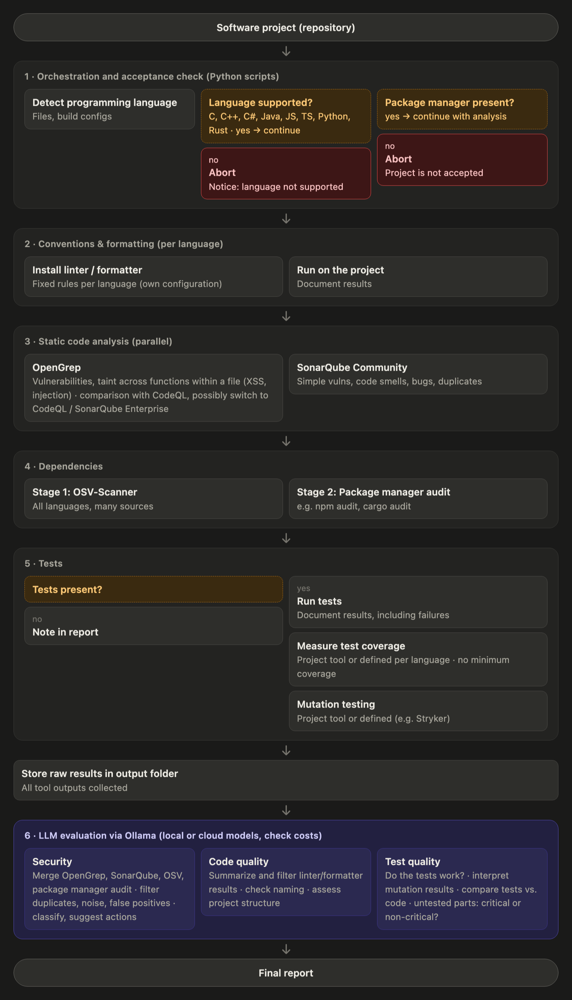

# Code-Analysis-Tool
Code analysis tool using locally hostesd LLMs as evaluators. The Scheduler for the Tool is writen in python

The tool itself ist deployed in docker using the docker compose file in /docker and uses a variety of static tools together with llms running in Ollama you can see the structure and what technoligies are used in this flow chart:



## Running the tool

Requirements: Docker (Docker Desktop on macOS/Windows) and, for the LLM evaluation, [Ollama](https://ollama.com) running on the host.

1. Configure the deployment (once):
   ```sh
   cp docker/.env.example docker/.env
   ```
   In `docker/.env`, set:
   - `PROJECTS_DIR` to the folder that contains your projects. It is mounted **read-write** at the same path inside the container, so you can paste host paths unchanged. Only projects below this folder can be analyzed.
   - `OUTPUT_DIR` to the folder for the results, outside your projects. It is created if missing.
   - `SONARQUBE_ADMIN_PASSWORD` and `SONARQUBE_DB_PASSWORD` for SonarQube (step 3). The admin password needs at least 12 characters with an uppercase and a lowercase letter, a digit and a special character. The tool sets it on SonarQube's first start; you log in with it at http://localhost:9000.
   - Optional: `CONAN_AUDIT_TOKEN` for `conan audit` in step 4 (free registration at https://audit.conan.io/register).
2. Build the tool images: linters/formatters, OpenGrep, the SonarQube scanners, the dependency checks and the test images. Do this once, and again after changes in `docker/linters/`, `docker/static-analysis/`, `docker/dependencies/`, `docker/tests/` or the rule sets in `config/opengrep.toml`. It downloads the toolchains (about 5 GB; the six test images of step 5 take about 10 GB more disk space):
   ```sh
   docker compose -f docker/docker-compose.yml --profile tools build
   ```
3. Build and start the containers (from the repository root):
   ```sh
   docker compose -f docker/docker-compose.yml up -d --build
   ```
   The scheduler container starts and waits; nothing is analyzed yet. The SonarQube server and its database start too and keep running. SonarQube needs at least 4 GB of RAM (give Docker Desktop enough memory). On Linux it also needs `sudo sysctl -w vm.max_map_count=524288` and `sudo sysctl -w fs.file-max=131072` (see SonarQube's Linux pre-installation guide).
4. Run the tool, from any terminal and as often as you like:
   ```sh
   bin/code-analysis
   ```
   It asks for the project path and runs the analysis inside the container. The container keeps running afterwards for the next run. To skip the prompt, pass the path: `bin/code-analysis --path /path/to/project`. To only check whether a project is accepted, without changing anything, add `--check-only`.

   To call it from anywhere as `code-analysis`, link the script into a folder on your `PATH`, e.g. `ln -s "$PWD/bin/code-analysis" ~/.local/bin/code-analysis`. Without the script (e.g. on Windows): `docker exec -it code-analysis-scheduler code-analysis`.
5. Stop the containers when you are done (SonarQube's data stays in Docker volumes; `down -v` would delete it):
   ```sh
   docker compose -f docker/docker-compose.yml down
   ```

After changes to the scheduler code, rebuild with `up -d --build` again.

### Acceptance check (step 1)

A project is accepted when:
- its primary language (largest share of source code) is one of C, C++, C#, Java, JavaScript, TypeScript, Python or Rust,
- it uses a package manager for that language, e.g. `pyproject.toml` / `requirements.txt`, `package.json`, `pom.xml` / `build.gradle`, `*.csproj`, `Cargo.toml`; for C/C++ only Conan (`conanfile.txt` / `conanfile.py`) or vcpkg (`vcpkg.json`) count,
- it is a git repository without uncommitted changes. Later steps (formatter) modify files, so every change must be reviewable and revertible with git.

Language shares are bytes of source code per language, as on GitHub. A `.h` file counts as C, C++ or Objective-C depending on its content (GitHub Linguist's rule). Generated files are not counted (see [Generated files](docs/linterConventions/README.md#generated-files)); the output names how many were left out.

| Exit code | Meaning |
|---|---|
| 0 | Project accepted (and, without `--check-only`, steps 2 to 5 completed) |
| 1 | Invalid input or no project selected |
| 2 | Language not supported, or no source code found |
| 3 | No package manager found for the primary language |
| 4 | Not a git repository, or uncommitted changes |
| 5 | Step 2 incomplete: `OUTPUT_DIR`, Docker or a tool image missing, a tool failed, or a project file could not be moved back |
| 6 | Step 3 incomplete: OpenGrep or SonarQube failed, e.g. `config/opengrep.toml` invalid, a tool image missing or outdated, the SonarQube server not running or `SONARQUBE_ADMIN_PASSWORD` missing |
| 7 | Step 4 incomplete: Docker or a tool image missing, a dependency check failed, or a lock file could not be generated (completely) |
| 8 | Step 5 incomplete: `config/tests.toml` invalid, Docker or a test image missing, or the tests of a suite could not be run (e.g. the build failed) or their coverage or mutation testing failed |
| 125 | (`bin/code-analysis` only) Docker or the container is not running |

### Linters and formatters (step 2)

After the project is accepted, the tool runs a fixed formatter and linter per language, as defined in [docs/linterConventions/README.md](docs/linterConventions/README.md). It covers every supported language found in the project, however small its share (e.g. a single C file in a Java/C++ project). A language is skipped in step 2 only if git knows none of its files (all of them ignored or in vendored/build folders).

- **What changes in the project:** the formatters and automatic fixes change files in the project. The changes stay **uncommitted**: review them with `git diff`, then commit or discard them. Until then, step 1 rejects the project on the next run. Configuration files of the project that the tools would otherwise read (`.editorconfig`, `biome.json`, `.clang-format-ignore`) are moved out during the run and moved back afterwards.
- **Generated files** (e.g. SWIG or protobuf output, minified JavaScript) are neither formatted nor linted. They are recognised by their content, see [Generated files](docs/linterConventions/README.md#generated-files).
- **How the tools run:** each tool runs in a fresh container of its language image (`code-analysis/lint-<language>`). The scheduler starts these containers through the Docker socket. Project code that the tools execute, such as build scripts, .NET analyzers or CMake, only runs in those containers, which don't get the socket.
- **Results** for step 6 are written to `OUTPUT_DIR/<project>/<date_time>Z/` (UTC):

| Path | Content |
|---|---|
| `run.json` | Project, commit, start time, result of step 1 |
| `step2-linting/summary.json` | One entry per tool: version, commands, exit codes, status (`ok`, `partial`, `failed`, `skipped`), duration, changed files, number of findings, notes |
| `step2-linting/findings.json` | Findings of all tools in one format: tool, rule, severity, message, file, line, column |
| `step2-linting/changes.patch` | All changes the tools made to the project |
| `step2-linting/excluded-files.json` | Generated files that were neither formatted nor linted, each with the reason |
| `step2-linting/<language>/<tool>/` | Raw output of each tool (SARIF reports, stdout/stderr) and the tool's own `changes.patch` |
| `step2-linting/cpp-build/` | C/C++ only: the CMake build folder generated for `compile_commands.json` |

### Static code analysis (step 3)

After step 2, OpenGrep and SonarQube Community Build analyse the project in parallel, as defined in [docs/staticAnalysis/README.md](docs/staticAnalysis/README.md). Step 3 also runs when a tool of step 2 failed, and each tool runs even if the other fails.

**OpenGrep** searches for vulnerabilities with rule sets.
- **Rules:** OpenGrep ships no rules. The rule sets are defined in [`config/opengrep.toml`](config/opengrep.toml), and `rulesets` there lists the active ones:
  - `opengrep-rules`, the OpenGrep fork of the Semgrep rules;
  - `semgrep-rules`, Semgrep's current rules. Results produced with them must not be published (see [Licenses](docs/staticAnalysis/README.md#licenses)).
  - `0xdea-semgrep-rules`, for C and C++.

  To switch, edit `rulesets` in that file and rebuild the OpenGrep image (`docker compose -f docker/docker-compose.yml --profile tools build opengrep`). Only active rule sets are downloaded. A new rule set needs a `[rulesets.<name>]` entry. The rules are stored only in the local image, never in this repository.
- **What it scans:** the working tree as step 2 left it, with the files git knows. OpenGrep's own default ignore list applies (e.g. `tests/`, `build/`, `vendor/`, `node_modules/`), and the project's `.semgrepignore` is ignored. With `--taint-intrafile`, OpenGrep follows data across functions within a file, not across files.
- **How it runs:** in a fresh container of `code-analysis/opengrep`, without network and with the project mounted read-only, so it cannot change the code.

**SonarQube** finds bugs, code smells, vulnerabilities and duplications, and measures the code (lines, complexity).
- **Server:** SonarQube Community Build 26.9 with PostgreSQL, started by `up -d`. Its web interface at http://localhost:9000 shows each analysed project with its history (user `admin`, `SONARQUBE_ADMIN_PASSWORD`).
- **Languages:**
  - C#, Java, JavaScript, TypeScript, Python and Rust use the official analyzers.
  - C and C++ use the community plugin sonar-cxx. Its own default profile activates no rule, so the tool uses the profile "Sonar way + sonar-cxx rules": the plugin's 22 own rules (complexity, size, naming, layout), without `cxx:FileHeader`, which reported every file. They find maintainability problems, not bugs; those come from clang-tidy (step 2) and OpenGrep.
- **Rules:** the default quality profile "Sonar way" of each language (C/C++: see above). The project's `sonar-project.properties` is ignored, and so are the folders and generated files that steps 1 and 2 leave out.
- **How it runs:** the scanners (`code-analysis/sonar-scanner`, `code-analysis/sonar-dotnet`) work on a copy of the project in the run folder, so the project is not changed. Java projects are compiled first with their Maven or Gradle, because SonarQube's Java analysis needs the bytecode. Projects with C# are analysed during `dotnet build`. If a build fails, the language is analysed with less precision or not at all, and the status is `partial`.

**Results** for step 6 go into the same run folder:

| Path | Content |
|---|---|
| `step3-static-analysis/summary.json` | Per tool: version, commands, exit codes, status (`ok`, `partial`, `failed`, `skipped`), duration, rule sets or quality profiles, findings per severity and category, SonarQube's metrics and duplicated files, notes |
| `step3-static-analysis/findings.json` | Findings of both tools in one format: tool, rule set, rule, severity, message, language, file, position, category, CWE, OWASP, confidence, likelihood, impact |
| `step3-static-analysis/opengrep/` | OpenGrep's JSON and SARIF reports, stdout/stderr |
| `step3-static-analysis/sonarqube/` | SonarQube's scanner parameters and logs, and the Web API answers (`api/`: issues, hotspots, metrics, duplications, rules) |

**Docker socket on Linux:** the scheduler needs the group of `/var/run/docker.sock` to start containers. The default (991) fits Docker Desktop. On Linux, set `DOCKER_SOCKET_GID` in `docker/.env` to the output of `stat -c %g /var/run/docker.sock`; the tool prints the right value if it is wrong.

### Dependencies (step 4)

After step 3, the project's dependencies are checked for known vulnerabilities, as defined in [docs/dependencyAudit/README.md](docs/dependencyAudit/README.md).
- **Stage 1:** OSV-Scanner checks the lock files of all ecosystems.
- **Stage 2:** the audit of each package manager step 1 found: npm, Yarn, pnpm, Bun, `cargo audit`, `dotnet package list --vulnerable` and `pip-audit`. `conan audit` runs only with a token.
- **Parallel:** all checks run at the same time.

**How it runs:**
- All checks work on a copy of the project in the run folder.
- Missing lock files (e.g. `Cargo.lock`, `package-lock.json`, `packages.lock.json`, `gradle.lockfile`) are generated there with the package manager's own command; the project is not changed.
- Gradle: every configuration of every module is locked, also build tooling (e.g. plugin configurations). Each Gradle finding is tagged with its configurations and a scope (`runtime`, `compile`, `test`, `tooling`).

**Network:** the checks query OSV.dev, deps.dev and the package registries. Package names and versions of the project leave the machine.

**Gaps:**
- Maven and Gradle have no audit of their own, but OSV-Scanner covers them.
- The OSV database has no data for Conan packages; only `conan audit` with a token covers them.
- vcpkg and Conda are not checked at all.

| Path | Content |
|---|---|
| `step4-dependencies/summary.json` | Coverage per manifest (lock file committed, generated, partial, failed or not supported; tools), per check: version, commands, status, findings per severity, notes; Gradle findings per scope |
| `step4-dependencies/findings.json` | Findings in one format: tool, package manager, manifest, package, version, advisory id and aliases (CVE, GHSA, …), severity, CVSS, summary, fixed versions, URL; for Gradle the configurations and the scope |
| `step4-dependencies/osv-scanner/`, `audits/` | Raw reports of OSV-Scanner and of each audit |
| `step4-dependencies/lockfiles/` | The lock files generated for the checks |

### Tests (step 5)

After step 4, the tool finds and runs the project's tests, measures their coverage and tests them with mutants, as defined in [docs/testAnalysis/README.md](docs/testAnalysis/README.md).

- **Finding the tests:**
  - A test suite holds the tests of one build unit, e.g. a Python project, a `package.json`, a Maven or Gradle build, a .NET test project, a Cargo workspace or a CMake project.
  - Tests are found from the files git knows, with the default conventions of the test frameworks (e.g. pytest's `test_*.py`, Jest's `__tests__/` and `*.test.js`, JUnit's `@Test`, Rust's `#[test]`, CTest's `add_test`).
  - A language without tests is named in the output and noted in the results.
  - C/C++: only CMake projects with a `CMakeLists.txt` in the project folder are checked.
- **Running the tests:**
  - Each suite runs in a fresh container of its language's test image (`code-analysis/test-<language>`), on a copy of the project, with the project's framework or build tool: pytest, Jest/Vitest/Mocha/`node:test`/Bun, Maven/Gradle, `dotnet test`, `cargo test`, CTest.
  - Failing tests are results, not errors.
  - JavaScript tests that need a browser (Playwright, Cypress, Karma) and Conda environments are not run.
- **Network:** the tests execute the project's code, so they run **without network** by default.
  - Only the download of the dependencies before them has network.
  - To let the tests use the network, set `network = true` in [`config/tests.toml`](config/tests.toml). Only do this if you trust the project's code.
  - The same file sets the time limit per test run (`time_limit_minutes`, default 60, `0` for no limit). The tool reads it at every run.
- **Changes of step 2:** if step 2 changed the project, the tests also run on the last commit (HEAD), and tests that end differently are listed. Without differences, nothing is reported.
- **Coverage:** after the tests, a second run measures the line and branch coverage with one tool per language: coverage.py, Jest/Vitest/c8, JaCoCo, coverlet, cargo-llvm-cov, gcovr. There is no minimum. It counts the program's source files, not the tests; source files no test loaded are listed.
- **Mutation testing:** mutmut, StrykerJS, PIT, Stryker.NET and cargo-mutants change the source code in small ways and check whether the tests notice. Tests that failed are left out where the tool allows it (StrykerJS cannot: such suites are skipped). C/C++ is not supported. `[mutation]` in [`config/tests.toml`](config/tests.toml) sets the scope and the time limit:
  - `mode = "sample"` (default): a reproducible random sample of `sample_files` (default 20) source files the tests cover. `mode = "full"`: every source file, which can take hours on large projects.
  - `time_limit_minutes` (default 60, `0` for no limit) per mutation run; results written until then are kept.

| Path | Content |
|---|---|
| `step5-tests/summary.json` | The test suites (language, folder, package manager or build tool, frameworks, test files), the languages without tests and those not checked; per test run: tool, version, status, number of tests per outcome, failed tests, commands, notes; differences to HEAD if any; coverage and mutation score per suite |
| `step5-tests/tests.json` | Every test: suite, id, outcome (`passed`, `failed`, `error`, `skipped`), duration, failure message |
| `step5-tests/coverage.json` | Coverage per source file: lines, branches, uncovered line numbers; source files no test loaded |
| `step5-tests/mutants.json` | Every mutant: file, line, kind, change, state (`Killed`, `Survived`, `NoCoverage`, …); the source line of mutants the tests did not detect |
| `step5-tests/<nn>-<language>-<folder>/` | Logs and raw reports of each run (`run/`, `run-head/` for the comparison, `coverage/`, `mutation/`) |

### Ollama

The container reaches Ollama at `http://host.docker.internal:11434` (change it with `OLLAMA_BASE_URL` in `docker/.env`). With Docker Desktop the default Ollama setup works. On Linux, Ollama must listen on all interfaces (`OLLAMA_HOST=0.0.0.0 ollama serve`), and `HOST_UID` / `HOST_GID` should be set in `docker/.env` so files written by the tool keep your ownership.

### Network

All containers join the bridge network `code-analysis-net`, including the linter/formatter containers of step 2 (they download dependencies, e.g. crates or NuGet packages). The OpenGrep container of step 3 has no network: its rules are part of the image. The SonarQube scanners use the network to reach the server (`http://sonarqube:9000`) and, for builds, the dependencies. The SonarQube server is published only on `127.0.0.1:9000`. The containers of step 4 use the network to resolve dependencies and to query OSV.dev, deps.dev and the registries. In step 5, only the download of the dependencies has network; the tests themselves run without it (`--network none`) unless `config/tests.toml` allows it.

### Development

```sh
cd scheduler
python3 -m venv .venv
.venv/bin/pip install -e '.[dev]'
.venv/bin/pytest
```

The integration tests of steps 2 to 5 run the real tool images and are skipped by default; those of steps 4 and 5 need internet access. The SonarQube tests also need the running server (`up -d`) and `SONARQUBE_ADMIN_PASSWORD` (environment or `docker/.env`). They need a folder that Docker can mount; on macOS the temporary folder is not shared, so use one below your home folder:

```sh
CODE_ANALYSIS_DOCKER_TEST_DIR=~/code-analysis-results/_itest .venv/bin/pytest -m docker
```
